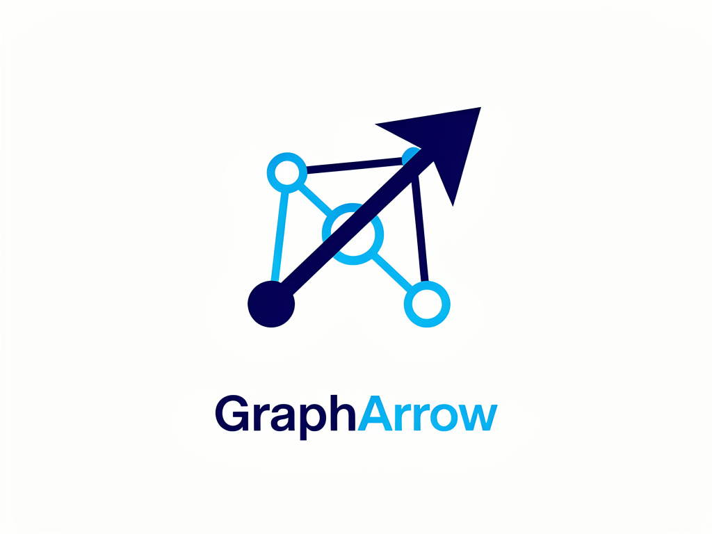

<div align="center">

  

# GraphArrow
</div>

GraphArrow is an embedded property graph database built in Python on top of PyArrow and Parquet.

The project is experimental: query APIs and storage formats are evolving.
It provides embedded Python, REST, Bolt and ANA agent interfaces. See the
[supported Cypher subset](docs/cypher-v1.md) and
[ANA HTTP interface](docs/ana-interface.md) before integrating it.
Cypher support is incomplete; see the [correctness status and remaining gaps](docs/known-cypher-issues.md).
The [transaction and session guide](docs/transactions.md) explains write
visibility, local writer coordination, conflict handling and object-storage limits.

## Goals

- Embedded Python-first graph database
- Columnar storage with PyArrow
- Parquet-backed persistence
- Cypher / openCypher query support
- Local and remote object storage support
- Snapshot-based storage and transaction model

## Getting Started

See [CI and Releases](docs/releases.md) for the Python test matrix, downloadable
release wheels and versioned Docker images. Release publication starts when a
maintainer pushes a matching `v*` tag; it is separate from ordinary main/PR CI.

This project requires Python 3.11+, Git and `uv`. ANA is installed with the
standard dependencies; no optional extra or adjacent checkout is needed.

### Install dependencies

```bash
uv sync --locked
# or
make sync-dev
```

### Start authenticated HTTP and Bolt servers

First follow [Prepare a local configuration](docs/server-configuration.md#prepare-a-local-configuration)
to generate separate REST, ANA and Bolt credentials. Then, from the repository
root, start HTTP in one terminal:

```bash
set -a
. ./.local-secrets/server.env
set +a
uv run --locked grapharrow-server --host 127.0.0.1 --port 8000
```

This starts REST and ANA together. To also use Bolt, start a second process in
another terminal:

```bash
set -a
. ./.local-secrets/server.env
set +a
uv run --locked grapharrow-bolt --host 127.0.0.1 --port 7687 --no-query-log
```

Both commands use `GRAPHARROW_DATABASE_PATH` from the generated configuration.
They initialize the database if needed and run in the foreground. Keep them
running while using a third terminal for clients. The
[server configuration guide](docs/server-configuration.md) includes REST, ANA
and Bolt client examples, environment settings, network access and Docker.

REST and Bolt authentication are optional unless configured. ANA credentials
protect only ANA routes; configure each interface before exposing it. The
example above binds both listeners to loopback and configures all three
credentials. Bolt query logging is disabled; it is enabled by default.

### Run tests

```bash
uv run pytest
# or
make test
```

### Run lint checks

```bash
uv run ruff check .
# or
make lint
```

### Run type checks

```bash
uv run mypy src
# or
make typecheck
```

### Run the full local check suite

```bash
make check
```

### Run the backend comparison benchmark

```bash
make benchmark-backends
# or
uv run --locked --group benchmark python scripts/benchmark_backends.py
```

The runner compares PyArrow, pandas, Polars and DuckDB on shared synthetic
Parquet data. New reports go to `.benchmarks/backend_evaluation/`.
See the [backend evaluation](docs/data-access-backend-evaluation.md) for the
historical measurements and a smaller smoke run.

### Explore the CLI

```bash
uv run grapharrow --help
# or
make cli-help
```

### Explore the REST server

```bash
uv run grapharrow-server --help
# or
make server-help
```

### Explore the Bolt bootstrap entrypoint

```bash
uv run grapharrow-bolt --help
# or
make bolt-help
```

### REST endpoints

Current bootstrap endpoints:

- `GET /v1/health`
- `POST /v1/query`
- `POST /v1/nodes`
- `POST /v1/edges`
- `POST /v1/triples`
- `GET /v1/admin/verify`
- `POST /v1/admin/recover`

### Example REST calls

In the client terminal, export the generated credentials before making requests:

```bash
set -a
. ./.local-secrets/server.env
set +a
```

Create a node with the imperative API:

```bash
curl --fail-with-body -X POST http://127.0.0.1:8000/v1/nodes \
  -H "Authorization: Bearer ${GRAPHARROW_SERVER_AUTH_TOKEN}" \
  -H "Content-Type: application/json" \
  -d '{
    "labels": ["Person"],
    "properties": {
      "external_id": "alice",
      "name": "Alice"
    }
  }'
```

Run a Cypher query:

```bash
curl --fail-with-body -X POST http://127.0.0.1:8000/v1/query \
  -H "Authorization: Bearer ${GRAPHARROW_SERVER_AUTH_TOKEN}" \
  -H "Content-Type: application/json" \
  -d '{
    "query": "MATCH (n:Person) WHERE n.name = $name RETURN n",
    "params": {
      "name": "Alice"
    }
  }'
```

Create Bob before connecting the two people:

```bash
curl --fail-with-body -X POST http://127.0.0.1:8000/v1/nodes \
  -H "Authorization: Bearer ${GRAPHARROW_SERVER_AUTH_TOKEN}" \
  -H "Content-Type: application/json" \
  -d '{"labels":["Person"],"properties":{"external_id":"bob","name":"Bob"}}'
```

Create an edge using explicit business-key references:

```bash
curl --fail-with-body -X POST http://127.0.0.1:8000/v1/edges \
  -H "Authorization: Bearer ${GRAPHARROW_SERVER_AUTH_TOKEN}" \
  -H "Content-Type: application/json" \
  -d '{
    "source_ref": {
      "label": "Person",
      "key": "external_id",
      "value": "alice"
    },
    "target_ref": {
      "label": "Person",
      "key": "external_id",
      "value": "bob"
    },
    "rel_type": "KNOWS",
    "properties": {
      "since": 2025
    }
  }'
```

### Bootstrap and inspect a local database

```bash
uv run grapharrow init /tmp/grapharrow-db
uv run grapharrow show-catalog /tmp/grapharrow-db
uv run grapharrow show-snapshot /tmp/grapharrow-db
uv run grapharrow verify /tmp/grapharrow-db
uv run grapharrow recover /tmp/grapharrow-db
```

The same workflows are also exposed through `make` targets that accept `DB=/path/to/database`.

### Bulk ingest from the CLI

Import nodes from a JSON array:

```bash
uv run grapharrow bulk-add-nodes /tmp/grapharrow-db ./nodes.json --default-label Person
```

Import edges from a JSONL file using explicit business-key references:

```bash
uv run grapharrow bulk-add-edges /tmp/grapharrow-db ./edges.jsonl \
  --source-label Person \
  --source-key external_id \
  --target-label Person \
  --target-key external_id
```

`bulk-add-nodes` and `bulk-add-edges` accept:

- `.json` files containing an array of objects
- `.jsonl` files containing one JSON object per line

### Direct tabular import from CSV and Parquet

Import nodes from CSV or Parquet:

```bash
uv run grapharrow import-nodes /tmp/grapharrow-db ./nodes.csv
uv run grapharrow import-nodes /tmp/grapharrow-db ./nodes.parquet --default-label Person
```

Import edges from CSV or Parquet:

```bash
uv run grapharrow import-edges /tmp/grapharrow-db ./edges.parquet
uv run grapharrow import-edges /tmp/grapharrow-db ./edges.csv \
  --source-label Person \
  --source-key external_id \
  --target-label Person \
  --target-key external_id
```

Simple tabular conventions:

- nodes:
  - `labels` column is optional when `--default-label` is provided
  - `labels` can contain multiple labels separated by `;`
  - every other column becomes a node property
- edges:
  - either `src_id`, `dst_id`, `rel_type`
  - or `src_key`, `dst_key`, `rel_type` plus explicit source/target label and key flags
  - every other column becomes a relationship property

## Real Object Storage

GraphArrow can work with URI-based database roots, including cloud object storage paths handled
through `pyarrow.fs`, for example:

- `s3://bucket/prefix/example-db`
- `gs://bucket/prefix/example-db`
- `az://container/prefix/example-db`

The repository already contains:

- local-disk integration tests
- S3-compatible integration tests via `moto`
- optional live integration tests for real S3, GCS, and Azure accounts

To run the live storage tests, configure one or more writable base URIs:

```bash
export GRAPHARROW_TEST_REAL_S3_URI="s3://my-grapharrow-tests/bootstrap"
export GRAPHARROW_TEST_REAL_GCS_URI="gs://my-grapharrow-tests/bootstrap"
export GRAPHARROW_TEST_REAL_AZURE_URI="az://grapharrow-tests/bootstrap"
make test-integration-live
```

GraphArrow can now also build cloud filesystem clients from explicit settings when needed.
The most relevant environment variables are:

- S3:
  - `GRAPHARROW_S3_ACCESS_KEY`
  - `GRAPHARROW_S3_SECRET_KEY`
  - `GRAPHARROW_S3_SESSION_TOKEN`
  - `GRAPHARROW_S3_REGION`
  - `GRAPHARROW_S3_ENDPOINT`
  - `GRAPHARROW_S3_SCHEME`
  - `GRAPHARROW_S3_ANONYMOUS`
- GCS:
  - `GRAPHARROW_GCS_ANONYMOUS`
  - `GRAPHARROW_GCS_ACCESS_TOKEN`
  - `GRAPHARROW_GCS_CREDENTIAL_TOKEN_EXPIRATION`
  - `GRAPHARROW_GCS_PROJECT_ID`
  - `GRAPHARROW_GCS_ENDPOINT`
  - `GRAPHARROW_GCS_SCHEME`
- Azure:
  - `GRAPHARROW_AZURE_ACCOUNT_NAME`
  - `GRAPHARROW_AZURE_ACCOUNT_KEY`
  - `GRAPHARROW_AZURE_SAS_TOKEN`
  - `GRAPHARROW_AZURE_CLIENT_ID`
  - `GRAPHARROW_AZURE_CLIENT_SECRET`
  - `GRAPHARROW_AZURE_TENANT_ID`
  - `GRAPHARROW_AZURE_BLOB_STORAGE_AUTHORITY`
  - `GRAPHARROW_AZURE_BLOB_STORAGE_SCHEME`
  - `GRAPHARROW_AZURE_DFS_STORAGE_AUTHORITY`
  - `GRAPHARROW_AZURE_DFS_STORAGE_SCHEME`

If these are not set, GraphArrow falls back to the default credential resolution provided by
`pyarrow.fs` and the underlying cloud provider environment.

## Docker

The repository includes two Docker images:

- `Dockerfile` for a lean runtime-style image with runtime dependencies only
- `Dockerfile.dev` for development and test workflows

Build the runtime image:

```bash
docker build -t grapharrow:runtime .
```

For authenticated HTTP/ANA and Bolt containers sharing a persistent database,
follow the [Docker server instructions](docs/server-configuration.md#docker).
The default image command starts HTTP/ANA; Bolt needs its own process. The
examples map both ports to host loopback and mount credentials read-only.

Build the development image:

```bash
docker build -f Dockerfile.dev -t grapharrow:dev .
```

## Current Status

The codebase includes:

- project metadata and tooling are configured with `uv`;
- the package is wired through `app.py` with settings, adapters, repositories, and use cases;
- the embedded API is exposed through the interfaces layer while keeping stable top-level imports;
- a minimal CLI exists for database bootstrap, inspection, verification, and recovery;
- a sync REST server exists for health checks, query execution, graph writes, and admin operations;
- the ANA interface is included and enabled by default, with authenticated workflows and native graph tools;
- a minimal Bolt 4.4 server is available for direct Neo4j-driver access on the bootstrap path;
- immutable catalog and snapshot metadata are persisted through staged manifests and a current snapshot pointer;
- Parquet-backed node, edge, node-label, and adjacency storage is implemented for the bootstrap engine;
- the official `openCypher` grammar is vendored and used for parsing through ANTLR;
- a useful executable Cypher subset is available end-to-end (`CREATE`, `MATCH`, `WHERE`, `RETURN`, `ORDER BY`, `SKIP`, `LIMIT`, connected multi-pattern `MATCH`, and bounded variable-length traversals);
- integration tests cover local disk, REST, Bolt, and S3-compatible storage via `moto`.

The most important remaining work is deeper Cypher coverage, richer Bolt semantics,
more production-ready object-storage behavior, and continued cleanup/documentation of
the compiler/executor internals.

## Documentation

See the [documentation index](docs/README.md) for technical guides and benchmark
reports. Versioned documentation, source code and comments are written in English.

The [ANA HTTP interface](docs/ana-interface.md) provides agent tool calls and
workflow sessions on `grapharrow-server` by default. Configure `ANA_AUTH_FILE`
to access its catalog/data endpoints, or use `--no-ana` to disable the interface.
Its tool catalog and runtime limits are documented.
